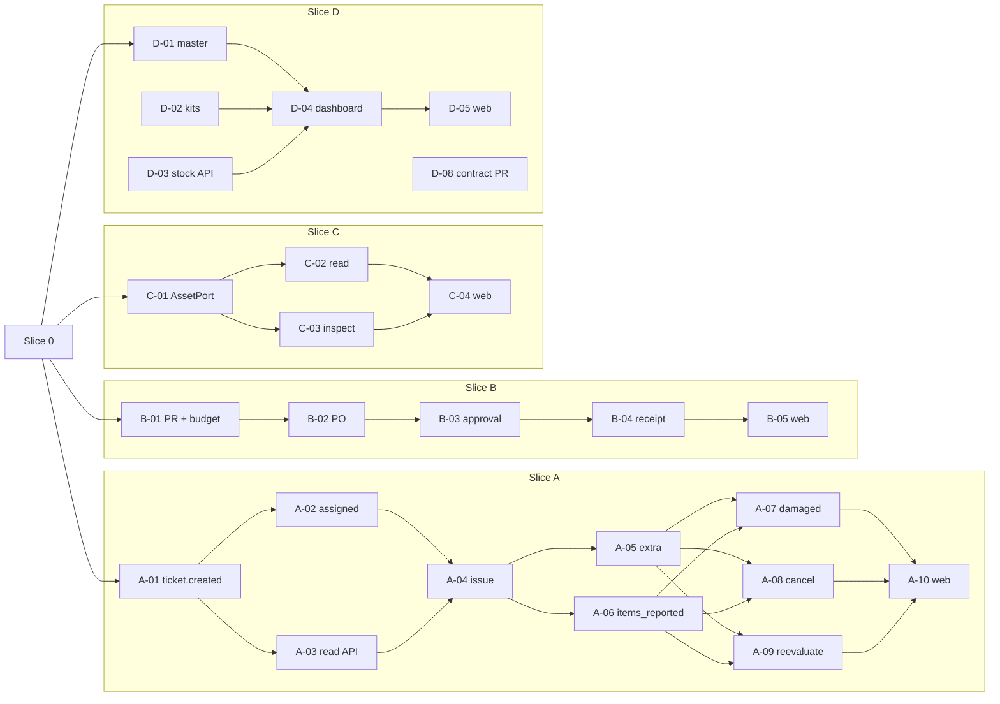

# Rencana kerja SCM

Rencana mengerjakan [`spec.md`](spec.md) oleh empat orang yang tidak saling menunggu. Daftar issue ada di [`issues/README.md`](issues/README.md). Dokumen ini tidak memuat tanggal; urutan ditentukan oleh fase dan ketergantungan.

## 1. Prinsip

1. **Slice vertikal.** Setiap orang memegang satu slice lengkap (API dan layar), bukan satu lapisan. Tidak ada yang menunggu API orang lain untuk membuat layarnya.
2. **Fondasi sekali.** Slice 0 membangun hal yang dipakai bersama (buku besar stok, tabel, migrasi, penerima event, kerangka web). Setelah Slice 0 di-merge, slice tidak mengubah `app/core/` dan tidak mengedit `main.py`.
3. **Port, bukan menunggu.** Ketergantungan antar-slice lewat antarmuka tetap di `app/core/ports.py`. Slice menguji dirinya dengan fake; port yang belum diimplementasikan gagal keras, tidak pura-pura berhasil. Lihat ADR-0003.
4. **Kontrak tidak memblokir.** Endpoint draf dikembangkan lebih dulu dari bentuk di `contract-extension.md`. Event yang belum dikontrakkan tidak diterbitkan.
5. **Berkas milik sendiri.** Setiap issue menyebut `touches`. Dua slice tidak pernah mengedit berkas yang sama.

## 2. Pembagian slice

| Slice | Pemilik | Fokus | Issue Tier 1 | Issue Tier 2 |
| :--- | :--- | :--- | :---: | :---: |
| 0 | Naufal | Fondasi | 6 | 0 |
| A | Naufal | Permintaan barang, reservasi, pengeluaran, laporan pemakaian | 10 | 2 |
| B | Makro | PR, cek anggaran, PO berjenjang, penerimaan barang | 5 | 1 |
| C | sam | Register ONT, status unit, retur dan pemeriksaan | 4 | 2 |
| D | mike | Data master, paket barang, API stok, dashboard, kontrak, tes end-to-end | 8 | 2 |

Naufal memegang Slice 0 dan Slice A (18 issue), jauh lebih banyak dari yang lain. Karena Slice 0 harus selesai lebih dulu, Makro, sam, dan mike membaca spesifikasi dan menyiapkan fake port selama menunggu, lalu mengambil issue Slice A yang belum dimulai (ubah `owner:` di berkas issue dan indeks; aturan `touches` tetap). Usulan awal: `SCM-A-08`, `SCM-A-09`, dan `SCM-A-10` diambil setelah slice sendiri selesai.

`owner:` di setiap berkas issue dan kolom Owner di `issues/README.md` harus selalu sama.

## 3. Fase

### Fase 0: Slice 0 (satu per satu, dibangun sebelum slice lain mulai)

Urutan: `SCM-0-01` → `SCM-0-05` → (`SCM-0-02`, `SCM-0-03`, `SCM-0-04`, `SCM-0-06` bersamaan). Slice 0 di-merge ke `main` sebagai satu kesatuan; sesudahnya slice A sampai D mulai bersamaan.

### Fase 1: Tier 1 (empat slice paralel)

Urutan di dalam slice (panah = harus lebih dulu, dalam slice yang sama):

Titik temu lewat port; tidak ada panah antar slice:

| Pemanggil | Port | Diimplementasikan oleh |
| :--- | :--- | :--- |
| A-01 (permintaan kurang stok) | `ProcurementPort.request_purchase` | B-01 |
| A-01, A-04, A-05, A-06, A-07, A-08 (unit serial) | `AssetPort.*` | C-01 |
| B-04 (penerimaan ONT) | `AssetPort.register_units` | C-01 |
| B-04 (setelah barang masuk) | `StockRequestPort.reevaluate_pending` | A-09 |
| C-03 (pemeriksaan retur) | `core/ledger` | Slice 0 |

Selama implementasinya belum ada, tes slice memakai fake lewat `ports.override`.

### Fase 2: Integrasi

Dimulai ketika `SCM-A-06`, `SCM-B-04`, dan `SCM-C-03` selesai.

1. `SCM-D-09`: tes end-to-end memakai semua implementasi nyata.
2. Perbaiki ketidakcocokan antar-slice dengan issue kecil di slice pemilik berkas yang salah.
3. `SCM-D-07`: status `LIVE` di `tracks/scm.md` dan panduan demo; jalankan panduan itu dari awal.
4. `SCM-D-08` (boleh dikerjakan kapan pun di Fase 1): PR kontrak bersama.

### Fase 3: Tier 2

`SCM-A-11`, `SCM-A-12`, `SCM-B-06`, `SCM-C-05`, `SCM-C-06`, `SCM-D-06`, `SCM-D-10`. Bebas urutan di antara slice.

### Fase 4: Lanjutan

Item di bagian "Lanjutan" `issues/README.md` (penerbitan event setelah kontrak di-merge) dan Tier 3 di `spec.md` bagian 2.

## 4. Aturan kerja tim

- **Cabang dan PR.** `scm/<id>-<slug>` dari `main`, satu issue satu PR. Judul PR dan commit: `feat(scm): <ringkas> (<id>)`; perbaikan `fix(scm): …`; dokumen `docs(scm): …`.
- **Tanpa atribusi agen.** Tidak ada `Co-Authored-By` atau kalimat "dibuat dengan <agen>" di commit atau PR (aturan 9 di `CONTEXT.md`). Hook `commit-msg` dan CI memeriksanya.
- **Berkas yang sering diedit bersama:** hanya `tracks/scm.md` (baris `provides` dan `consumes`) dan status di `issues/README.md`. Edit hanya barismu; bila bentrok saat rebase, gabungkan kedua baris, jangan menimpa.
- **Area bersama** (`services/shared/`, `contracts/`, `docker-compose.yml`, `.env.example`, `mysql/init/`, `CONTEXT.md`, `AGENTS.md`, `.github/`, `tools/`) tidak diubah oleh issue SCM kecuali `SCM-D-08`, dan itu lewat PR terpisah.
- **Migrasi.** Tabel sudah dibuat Slice 0. Perubahan skema berikutnya: berkas migrasi baru di cabang migrasi slice-mu, tidak mengubah migrasi yang sudah ada.
- **Tes.** `pytest -q services/scm-api/tests`; web `npm run build` di `apps/scm-web`. Jalankan hanya yang menyentuh issue-mu sebelum membuka PR.
- **Kontrak.** Sebelum menyentuh API atau event yang ada di `contracts/`, baca file kontraknya dan `variable_standards.md`. Jalankan `python tools/check_contracts.py` bila mengubah `tracks/scm.md`.
- **Status jujur.** `LIVE` hanya dengan tes lulus. Endpoint `DRAFT` tidak ditandai `LIVE`.

## 5. Definisi selesai satu issue

1. Semua kotak di "Kriteria penerimaan" dicentang.
2. Tes issue itu ada dan lulus; tes slice lain tidak rusak.
3. Hanya berkas di `touches` yang berubah.
4. `status: DONE` di berkas issue dan di tabel `issues/README.md`.
5. Untuk layar: `npm run build` lulus dan PR memuat tangkapan layar dari hasil yang benar-benar dijalankan.

## 6. Risiko dan penanganannya

| Risiko | Penanganan |
| :--- | :--- |
| Slice 0 lambat dan menahan semua | Slice 0 dibagi menjadi enam issue kecil; empat di antaranya bisa dikerjakan bersamaan sesudah `SCM-0-05` |
| Dua slice butuh perubahan di `core/` | Hanya lewat issue yang menyebutnya (`SCM-A-11`, `SCM-D-10`); selain itu, tulis permintaan ke pemilik Slice 0 |
| Kontrak bersama belum di-merge, layar tim lain butuh endpoint draf | Endpoint draf hanya dipakai `scm-web`; CRM dan Finance hanya memakai yang sudah `K` |
| Slice A terlalu berat | Pembagian ulang issue A sesuai bagian 2 |
| Port yang belum ada membuat alur gagal saat dijalankan penuh | Itu disengaja (gagal keras); `SCM-D-09` membuktikan semua port sudah terisi |
| Aturan "kontrak dulu" di `AGENTS.md` | Endpoint D belum di kontrak bersama; ini penyimpangan sementara yang diakui dan diakhiri oleh `SCM-D-08`. Beri tahu tim lain di PR kontrak |
